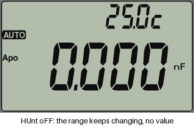

# 121GW-Open-Firmware — EEVblog 121GW open firmware port and emulator

## Downloads

Everything is on the [**latest release**](../../releases/latest):

| File | What it is |
|---|---|
| `firmware-<version>.zip` | the firmware for the meter (`EEVBlog.bin`) with its user guide |
| `121GW-User-Manual-<version>.pdf` | the user manual |
| `121GW-Companion-<version>-<platform>` | the 121GW Companion, the computer app for the meter over Bluetooth: live view, graphs, recording, firmware and bootloader updates, card files, settings (Windows, macOS, Linux) |
| `121GW-Open-Firmware-Emulator-<version>-<platform>` | the emulator of the meter (Windows, macOS, Linux) |

**User manual:** [**manual.pdf**](firmware/docs/manual/manual.pdf): how to use the meter with this firmware, every key,
every measuring function, every SETUP page and every message, with pictures of the display.

## 121GW Companion: the meter on your computer

A program for Windows, macOS and Linux that connects to the meter over Bluetooth: the live reading with statistics and a trend, a scope view with cursors, CSV recording, the meter's keys from the computer, firmware and bootloader updates without card or keys (two-part bootloader), the SD card's files, the meter's settings and clock. Download it from the [latest release](../../releases/latest) (`121GW-Companion-...`); its source and full description are on the branch [`companion`](../../tree/companion).

| **Scope view** | **Recording** |
|---|---|
|  |  |
| **SD card** (meter on the page `Ld-bt`) | **Meter**: settings and diagnostics (page `Ld-bt`) |
|  |  |

Recorded from a real 121GW with firmware F-1.07 over Bluetooth (nothing connected to the inputs, so the readings are small; the keys are pressed from the computer; the meter's Bluetooth device identifier is covered).

| Folder | Content |
|---|---|
| `firmware/` | new firmware for the 121GW (STM32L152ZD) in hand-written Thumb-2 assembly, loaded at 0x08006000 by the meter's existing bootloader or by the two-part bootloader (branch `bootloader`) |
| `emulator/` | emulator of the 121GW with a front-panel UI, used to run and test firmware without hardware |

This branch (`main`) is the fast build with the new features below, and the emulator. The build that behaves like the
original v2.05 with its defects fixed lives on the branch [`like-v2.05`](../../tree/like-v2.05) and has its own releases
(tags `like205-vA.B.C`). The two-part bootloader (firmware and bootloader updates over Bluetooth without card or keys,
exFAT cards) lives on the branch [`bootloader`](../../tree/bootloader) in the folder `bootloader/` and has its own releases
(tags `bl-vA.B.C`); the firmware's comments that name `bootloader/DESIGN.md`, `bootloader/README.md` or
`bootloader/tools/blimage.py` mean the files of that branch. The program that shows the meter live and updates it over
Bluetooth, the 121GW Companion, lives on the branch [`companion`](../../tree/companion) and has its own releases (tags
`companion-vA.B.C`).

## New features of the fast build

| Feature | Where | What it does |
|---|---|---|
| Backlight auto-off and memory | SETUP page `bL` | switches the backlight off after 30 s .. 99 min; any key or dial turn switches it on again; the on/off state is kept over a power-off |
| dBm reference | ACV, SETUP dBm page | dBm into 600, 50 or 75 ohm, or dBV |
| Bluetooth speed | SETUP page `bt` | 2, 4, 10 or 20 readings per second |
| REL in percent | SETUP page `rEL` | REL shows the deviation from the reference in % |
| Thermocouple type | TEMP, SETUP page `tc` | K, J, T, N, R or S probes |
| Display level | SETUP page `dSP` | less smoothing: small changes show about 4x sooner |
| 12-hour clock | SETUP page `CL` | time page in 12-hour form |
| Statistics | MIN/MAX, pages `n` and `Sd` | count and standard deviation of the readings |
| Continuity hold time | BEEP, SETUP page `bH` | beep latch 100 / 50 / 25 ms or off (15 ms) |
| 4–20 mA in percent | DC mA, SETUP page `LP` | a 4–20 mA or 0–20 mA loop signal shown as 0–100 % |
| PT100 / PT1000 | Ω, SETUP page `Pt` | a platinum RTD read as a temperature in °C or °F (IEC 60751) |
| Battery trim | SETUP page `BAT` | match the battery reading to a reference meter (±10 %, 0.2 % steps) |
| Firmware over Bluetooth | SETUP page `Ld`, `emulator/tools/bt_upload.py` | send a new `EEVBlog.bin` to the card without removing it |
| exFAT cards, long file names, card format | SETUP page `Fr` | reads and writes FAT12 / FAT16 / FAT32 / exFAT cards with long file names; `Fr` formats the card as exFAT (shown only with the two-part bootloader) |
| Two-part bootloader support | SETUP page `Ld`, the 121GW Companion | first install of the bootloader over Bluetooth; on request over Bluetooth the meter restarts into the bootloader's update mode (firmware and bootloader updates without card or keys) |
| Limit test | SETUP pages `Lt`, `Lo`, `HI` | PASS / HI / Lo verdict against captured limits, with beeps |
| Capacitance anti-hunting | CAP, SETUP page `HUnt` | keeps the 1 µF range for ceramic capacitors that make the range hunt (off by default) |
| Longer wait on the 100 nF range (experimental) | CAP, auto range | waits 2.5 s (v2.05: 2.0 s, 1.5 s with the PF8 strap) for a result on the 100 nF range before moving to the 1 µF range, so a slow capacitor of about 100 nF keeps the 100 nF range's resolution; how long such a capacitor takes is not measured |
| Extended link diagnosis | the 121GW Companion, SETTINGS (off by default) | the meter counts errors on its Bluetooth module's serial line (RAM only, nothing stored); the Companion's report shows the counts |
| Logging trigger | SETUP pages `tr`, `Ch` | SD records every interval, on a change, or on a limit verdict change |
| MIN/MAX times | MIN/MAX, pages `tHI`, `tLo`; SD file | when the maximum and the minimum happened, on the meter and in the closing rows of the log file |

How to set and use each one: [`firmware/USER_GUIDE.md`](firmware/USER_GUIDE.md). The like-v2.05 build (branch
`like-v2.05`) has none of these and behaves like the original firmware apart from the defect fixes.

## Anti-hunting (capacitance)

**The problem.** With some small ceramic capacitors of about 100 nF the capacitance range of the 121GW never settles: the
display keeps switching between the 100 nF and the 1 µF range, the digits stay blank and only the decimal point moves.
(Reported on the EEVblog forum.) On the 100 nF range such a capacitor gets no result in time, so after 2.5 s the meter
moves up to the 1 µF range; there the capacitor reads below 0.1000 µF, so the meter goes down again, and so on. Why those
capacitors get no result in time is not proven yet.

**The rule** (SETUP page `HUnt`, CAP only, **off by default**; the companion's METER view has the same setting). With `on`,
after the 100 nF range has found no result **twice in a row**, the meter stays on the 1 µF range and shows the value (about
`0.095` µF for 95 nF) as long as the capacitor reads 10 to 99.9 nF there. It lets go and ranges as usual when a different
capacitor is connected (the reading changes by more than 20 %), with open probes, when a result comes on the 100 nF range,
when you change the range by hand or press REL, when you change the function, and at power-off. Everything else in the
capacitance measurement is unchanged.

## Two-part bootloader (updates over Bluetooth)

Once installed (once per meter, from the 121GW Companion over Bluetooth, no SWD and no case opening), the firmware and the bootloader itself are updated from the companion without a card and without holding keys; the card route still works and also reads exFAT cards. How to install and use it, step by step: [`bootloader/README.md`](../../blob/bootloader/bootloader/README.md) (branch `bootloader`, releases `bl-vA.B.C`).

| First install | Firmware update | Format the card as exFAT |
|---|---|---|
|  |  |  |

## Release files

Every release of this branch (tag `vA.B.C`, see [Releases](../../releases)) carries:

| File | Content |
|---|---|
| `firmware-<tag>.zip` | `2_fast/EEVBlog.bin` (the fast build), `USER_GUIDE.md` (the new features and how to use them), `FIXES.md` (the v2.05 defects fixed), `LICENSE`, `SHA256SUMS` |
| `121GW-Open-Firmware-Emulator-<tag>-macos-arm64.dmg` | emulator for macOS on Apple chips (M1 and later) |
| `121GW-Open-Firmware-Emulator-<tag>-windows-x64.exe` | emulator installer for Windows 10 / 11 |
| `121GW-Open-Firmware-Emulator-<tag>-linux-amd64.deb` | emulator package for Ubuntu, Debian, Mint, Pop!_OS |
| `121GW-Open-Firmware-Emulator-<tag>-linux-x86_64.AppImage` | emulator for any other 64-bit Linux |
| `<file>.sha256` | SHA-256 of the file with that name |

The like-v2.05 releases (tag `like205-vA.B.C`) carry `firmware-<tag>.zip` with `1_like_v2.05/EEVBlog.bin`, `FIXES.md`,
`LICENSE` and `SHA256SUMS`. No file of a release contains an original EEVblog image (bootloader, v2.05) or the calibration
of any meter.

## Firmware
- Build (GNU binutils arm-none-eabi 2.46, the `Makefile` refuses other versions): `cd firmware && make`. `make check` runs the never-brick,
  HY3131-configuration and pin-policy checks and needs the original v2.05 image in `inputs/` (not in this repository);
  `make check-ci` runs the checks that do not need it and names the ones it skips. Output: `firmware/build/EEVBlog.bin`.
  `sh firmware/tools/build_dist.sh <dir>` builds it into the layout of the release archive.
- CI (`.github/workflows/firmware.yml`): on every push and pull request the firmware is built with GNU binutils 2.46.0
  (built from the release tarball, SHA-256 pinned; the packages of Ubuntu 24.04 and 26.04 are 2.42 and 2.45.50) and checked with `make check-ci`
  (`check_image`, `check_hy` against the committed reference data `firmware/tools/hy_reference.txt`, `check_gpio`; skipped:
  `gen_nvm_allow --check`, `gen_ram_symbols --check`, `extract_tables --verify`, which compare with the original image). On a
  tag `v*` the workflow publishes `firmware-<tag>.zip`.
- `DESIGN.md` design and deviation list, `EEPROM_MAP.md` every EEPROM byte, `ORIGINAL_FIRMWARE_ISSUES.md` the defects
  found in v2.05 (with evidence), `OPTIMIZATIONS.md`, `FEATURES.md` user-visible features (keys, display, storage; implemented in the production build: backlight
  auto-off timer with remembered on/off state, selectable dBm reference, Bluetooth frame rate 2/4/10/20 per second,
  thermocouple type K/J/T/N/R/S, REL in percent, display level, 12-hour clock, statistics, continuity hold time, limit test, logging trigger, MIN/MAX times, 4–20 mA percent, PT100/PT1000, battery trim, exFAT cards with long file names and card format, bootloader install and update requests over Bluetooth, capacitance anti-hunting and the longer 100 nF wait, extended link diagnosis), `HARDWARE_TEST.md` checklist for the first run on a meter.
- Status: the fast build is compared with v2.05 in the emulator's test scenarios; its differences are documented deviations
  (`firmware/deviations.txt`) except three display differences still open (battery_low, mem_logging_sd, sd_insert_remove).
  Verified on a meter, as `firmware/FEATURES.md` states for each feature (for example the limit test, the dBm reference, REL in
  percent, 20 readings per second, the logging trigger, statistics, backlight, the 12-hour clock, continuity hold time, firmware
  and bootloader updates over Bluetooth, the card format and the card clock, the companion's counters of the extended link
  diagnosis). Features without such a statement there (for example the thermocouple types, the 4–20 mA view, PT100 / PT1000 and
  the battery trim) are not recorded as verified on a meter. The capacitance anti-hunting (`HUnt`) is **not yet verified on a
  meter** (no suitable capacitor), and neither is how long a 100 nF ceramic capacitor takes on the 100 nF range.

### Flashing a meter from the SD card
Read `firmware/HARDWARE_TEST.md` first; it is the procedure and checklist.
1. Before flashing: dump the data EEPROM over SWD and save `cal.bin` to an SD card with v2.05 (HARDWARE_TEST.md, "Before
   flashing"). Keep both: they hold the meter's calibration, serial number and settings.
2. Unpack `firmware-<tag>.zip`. Copy `2_fast/EEVBlog.bin` (or `1_like_v2.05/EEVBlog.bin` of a like-v2.05
   release), unchanged, to the root of a FAT32 SD card (exFAT once the two-part bootloader is installed) as `EEVBlog.bin`. The bootloader looks for exactly this file name (FAT short names ignore case).
3. Run the manual's Firmware Update procedure (page 72, summarised in HARDWARE_TEST.md, "Flashing"). This route does not
   change EEVblog's bootloader (0x08000000..0x08005FFF); it writes the application from 0x08006000. Only the first install
   of the two-part bootloader (`bootloader/README.md` on the branch `bootloader`) replaces it. The data EEPROM is not touched.
4. First boot and checks: HARDWARE_TEST.md. To return to v2.05, flash the original image the same way; settings and
   calibration stay readable (same EEPROM layout).

## Emulator
- **[How to start it, step by step with pictures](emulator/START.md).** Download, one confirmation the first time
  (the packages are not paid-signed), then it starts with a double-click; nothing else to install. On macOS and Windows
  the front panel opens in its own window (closing it stops the emulator); on Linux in the browser.
- It downloads the firmware builds from the releases when you choose them in the page (fast at the first start; then
  kept in a cache, so the internet is needed once) and loads any other `EEVBlog.bin` with **Load firmware
  file…** or by dropping the file on the window; it runs them without any original image (direct boot from the
  application's vector table) and starts with a SYNTHETIC EEPROM: made-up nominal calibration, not the calibration of any
  meter, with no serial number. Never copy it, or a `cal.bin` written by the emulator, to a meter (since v1.0.6 the
  meter refuses a `cal.bin` whose serial number differs from its own: "-Err-", nothing written).
- From the source tree: `sh firmware/tools/build_dist.sh /tmp/dist none && python3 emulator/tools/prepare_data.py --dist /tmp/dist`
  once (fills `emulator/data`), then `python3 emulator/app.py` and open http://127.0.0.1:8121. Needs Python 3 with
  `unicorn` and `capstone`. Own files: `--eeprom`, `--bootloader`, `--option-bytes`, `--v205-image`, `--app`, `--sdcard`;
  the original images are not included: they are read from a meter.
- `emulator/API.md`: HTTP API (`GET /state`, `POST /input`), Python API, options, what direct boot does not reproduce.
- `emulator/diff/run.py` compares two firmware images scenario by scenario (see its docstring); it needs the original v2.05
  image as the reference.
- CI (`.github/workflows/emulator.yml`) builds the packages above on a tag and attaches them to the release.

## Licence

Free for individuals, schools and non-profits to use, modify and share; companies need written permission from zombu4; selling or bundling only by zombu4 and EEVblog (David L. Jones), who both keep full rights. See `LICENSE`.
